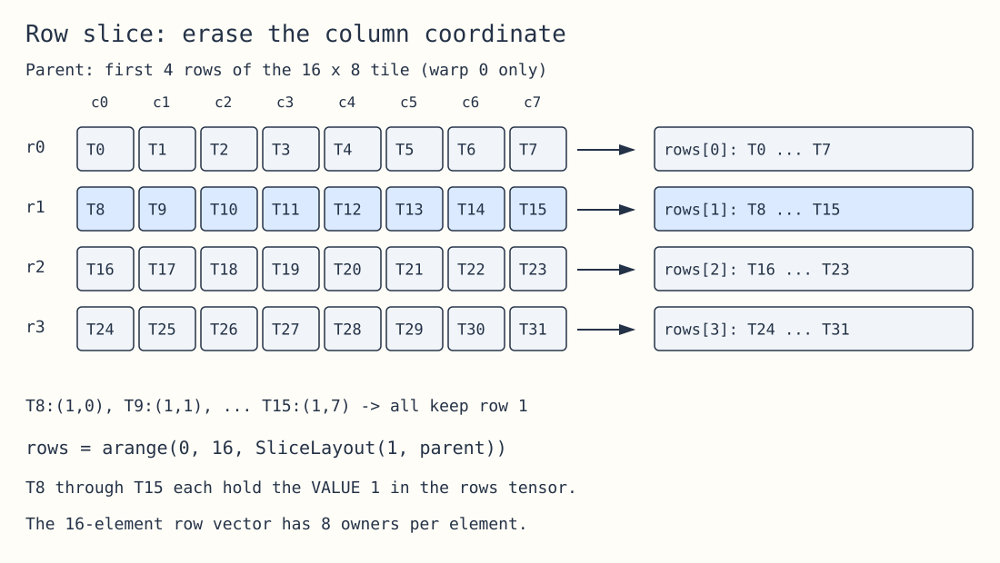
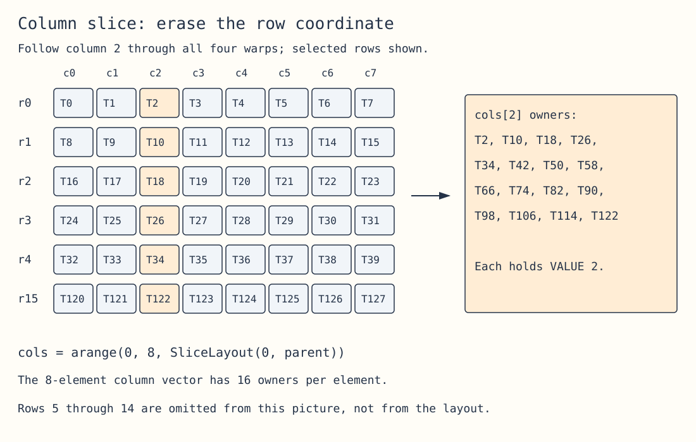
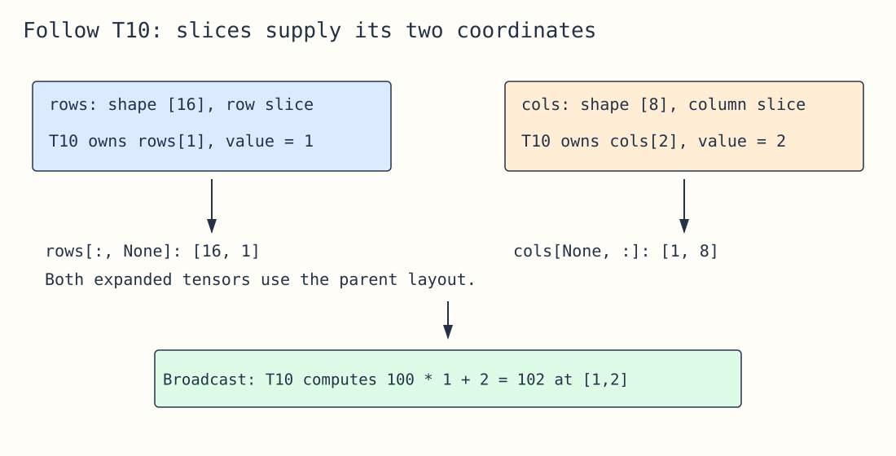
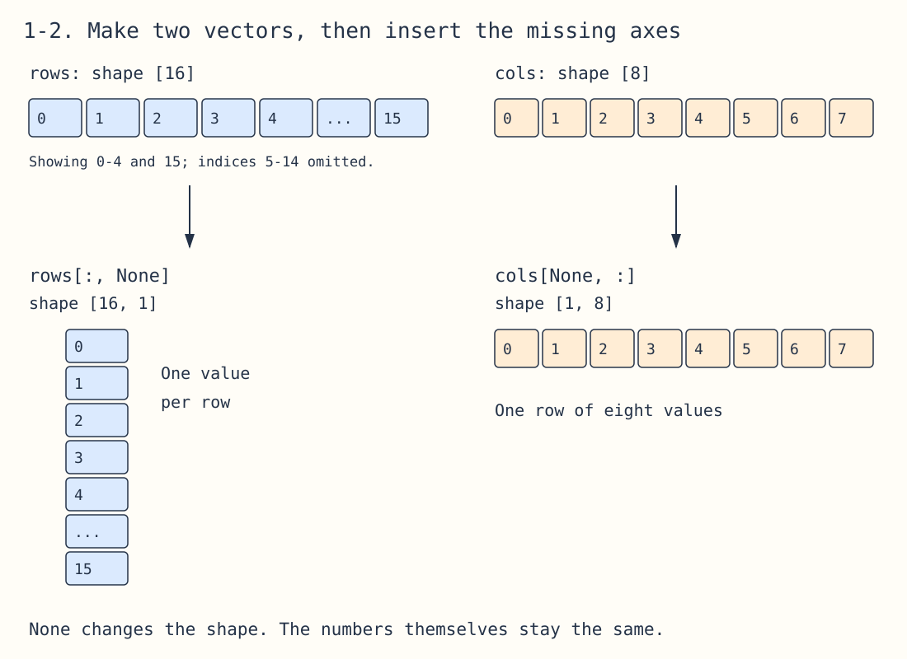
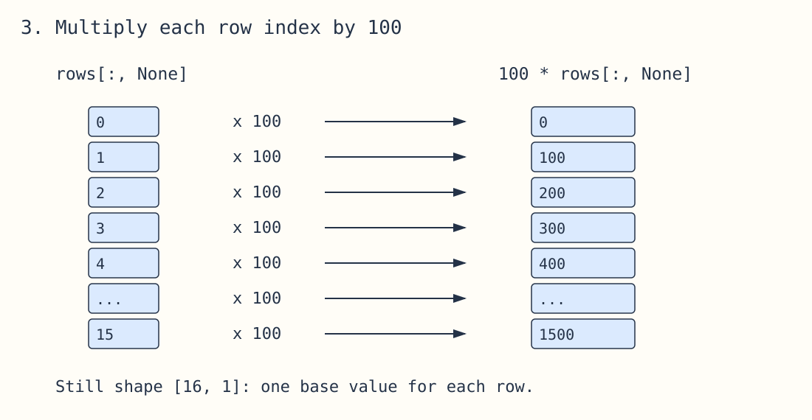
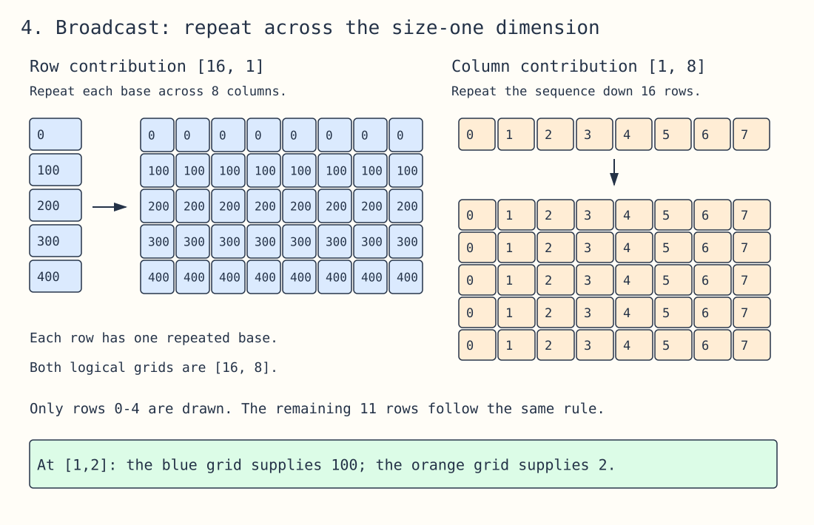
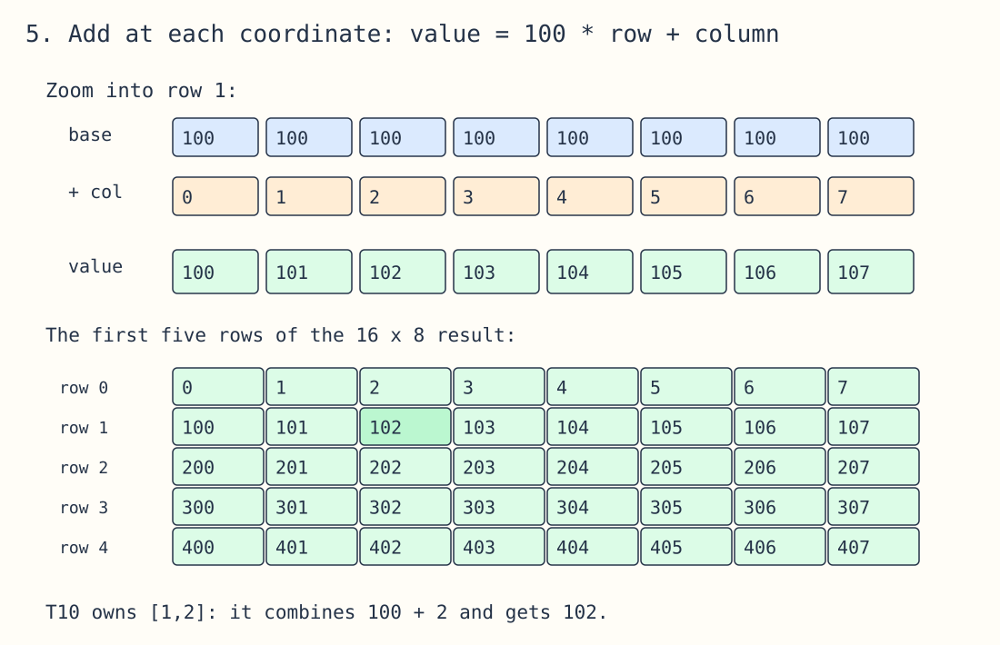
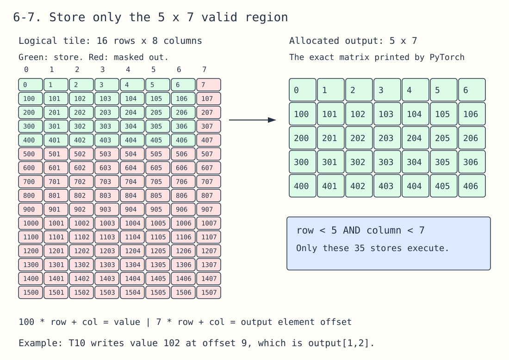
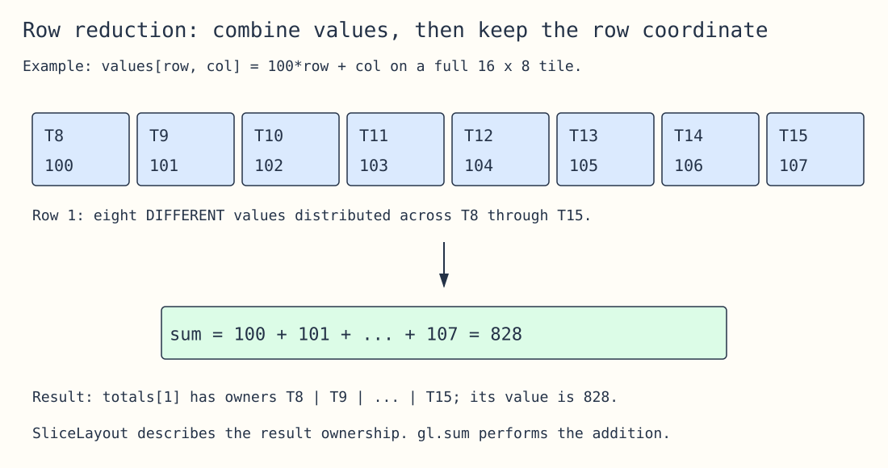

# Gluon sliced layouts — a visual guide

**Keep every thread in place, then erase one coordinate from its position.** Threads with the same remaining coordinate become owners of the same element in the sliced layout.

This guide explains the output from [11_visualize_layouts.py](11_visualize_layouts.py) and the kernels in [09_layout_practice.py](09_layout_practice.py). Read [the tensor layouts guide](tensor-layouts-visual-guide.md) first if thread, warp, and register ownership are still unfamiliar.

The diagrams render directly in Markdown. Each **Edit diagram** link opens an editable source file you can load using Open in [Excalidraw](https://excalidraw.com). Colors highlight the groups; labels also explain them.

## 1. Start with the parent you printed

```python
parent = gl.BlockedLayout(
    size_per_thread=[1, 1],
    threads_per_warp=[4, 8],
    warps_per_cta=[4, 1],
    order=[1, 0],
)
```

Use a logical tile of shape **[16, 8]**. One warp covers four rows and eight columns. Four warps stack vertically, giving 128 threads and 128 elements. Each thread owns one element.

```text
           col 0   col 1   col 2   ...  col 7
row  0       T0      T1      T2    ...    T7   ┐
row  1       T8      T9     T10    ...   T15   │ warp 0
row  2      T16     T17     T18    ...   T23   │
row  3      T24     T25     T26    ...   T31   ┘
row  4      T32     T33     T34    ...   T39     warp 1 starts
...
row 15     T120    T121    T122    ...  T127     warp 3 ends
```

For **this layout and shape**, the mapping is particularly simple:

```python
row = thread_id // 8
col = thread_id % 8
thread_id = 8 * row + col
```

For example, T10 owns `[1, 2]`. These formulas change when you change the layout or tile shape.

## 2. Read the punctuation before reading the whole printout

In the layout viewer:

| Printed notation | Meaning |
|---|---|
| `T10:0` | Thread 10, logical register slot 0 of this tensor |
| `T0:0 \| T1:0` | Both owners hold the same logical tensor element |
| A comma | Move to the next logical element in the vector |

Your row printout has **16 comma-separated entries**, each containing eight owners. Your column printout has **8 comma-separated entries**, each containing sixteen owners.

The viewer prints owners, not numerical values. The values become `0, 1, 2, ...` when you create an `arange` with that layout. If you load a bias vector instead, those same owners hold bias values.

Register slot numbers are local to the tensor being described. Slot 0 in `rows` and slot 0 in `cols` do not mean both tensors must use the same physical machine register.

## 3. Row slice: erase the column coordinate

For a matrix, dimension 0 is rows and dimension 1 is columns.

```python
row_layout = gl.SliceLayout(1, parent)
```

The `1` names the dimension being **removed**. Removing columns leaves rows.



[Edit diagram](assets/sliced-layouts/01-row-projection.excalidraw)

Trace the second row of the parent:

| Thread | Parent coordinate | Erase column | Row-vector element |
|---|---|---|---|
| T8 | `[1, 0]` | `[1, ~~0~~]` | `rows[1]` |
| T9 | `[1, 1]` | `[1, ~~1~~]` | `rows[1]` |
| T10 | `[1, 2]` | `[1, ~~2~~]` | `rows[1]` |
| … | … | … | … |
| T15 | `[1, 7]` | `[1, ~~7~~]` | `rows[1]` |

Every thread in this group keeps row coordinate **1**. That is why the viewer groups them with `|`:

```text
rows[0]  → T0:0  | T1:0  | ... | T7:0
rows[1]  → T8:0  | T9:0  | ... | T15:0
rows[2]  → T16:0 | T17:0 | ... | T23:0
...
rows[15] → T120:0 | ... | T127:0
```

Now create actual values inside a Gluon kernel:

```python
rows = gl.arange(0, 16, layout=gl.SliceLayout(1, parent))
```

T0–T7 each hold value **0**, T8–T15 each hold **1**, and T120–T127 each hold **15**. There are 16 distinct vector elements, replicated across eight threads each.

## 4. Column slice: erase the row coordinate

```python
col_layout = gl.SliceLayout(0, parent)
```

Removing rows leaves columns. Follow column 2 down the parent:



[Edit diagram](assets/sliced-layouts/02-column-projection.excalidraw)

```text
  T2: [ 0, 2] → keep column 2
 T10: [ 1, 2] → keep column 2
 T18: [ 2, 2] → keep column 2
 ...
T122: [15, 2] → keep column 2
```

All sixteen threads own `cols[2]`. Their IDs differ by eight because the parent has eight columns per row.

```python
cols = gl.arange(0, 8, layout=gl.SliceLayout(0, parent))
```

T2, T10, T18, …, T122 each hold the value **2** in this tensor. The eight-element vector has sixteen owners per element, spanning all four warps.

Compare the counts:

| Tensor | Shape | Distinct elements | Owners per element | Total ownership slots |
|---|---|---:|---:|---:|
| Parent tile | `[16, 8]` | 128 | 1 | 128 |
| Row vector | `[16]` | 16 | 8 | 128 |
| Column vector | `[8]` | 8 | 16 | 128 |

No threads disappear when you remove a layout dimension. The ownership becomes replicated along the removed dimension.

## 5. Why the kernel needs these two vectors

Each thread needs a row coordinate and a column coordinate to calculate the address of its element. For T10, those are **row 1** and **column 2**.



[Edit diagram](assets/sliced-layouts/03-thread-trace.excalidraw)

```python
rows = gl.arange(0, 16, layout=gl.SliceLayout(1, parent))
cols = gl.arange(0, 8, layout=gl.SliceLayout(0, parent))

values = 100 * rows[:, None] + cols[None, :]
```

Follow the shapes and layouts:

| Expression | Shape | Layout | Value held by T10 |
|---|---|---|---:|
| `rows` | `[16]` | `SliceLayout(1, parent)` | 1 |
| `rows[:, None]` | `[16, 1]` | `parent` | 1 |
| `cols` | `[8]` | `SliceLayout(0, parent)` | 2 |
| `cols[None, :]` | `[1, 8]` | `parent` | 2 |
| `100 * rows[:, None] + cols[None, :]` | `[16, 8]` | `parent` | 102 |

`None` inserts a size-one dimension. Inserting it at the dimension removed by the slice restores the parent layout. Broadcasting then combines `[16, 1]` and `[1, 8]` into `[16, 8]`.

The expanded tensors already have the parent layout, even though their shapes are smaller than the full tile. They retain replicated ownership along their size-one dimensions.

T10 computes **102 at `[1, 2]`**. T11 uses row 1 and column 3 to compute **103 at `[1, 3]`**. T18 uses row 2 and column 2 to compute **202 at `[2, 2]`**.

### Walkthrough: how the indices kernel produces the printed 5 × 7 matrix

The `indices` lesson generates each output value using this expression:

```python
values = 100 * rows[:, None] + cols[None, :]
```

The number **100 is a teaching choice**: it makes the row easy to recognize in each value. Row 3 produces 300, 301, 302, and so on. The kernel generates these numbers from coordinates; it does not load the input matrix printed by the practice script.

Follow the calculation first, then follow where each result is stored.

#### Step 1: create the two index vectors



[Edit diagram](assets/sliced-layouts/05-expand-vectors.excalidraw)

The kernel uses `R=16` and `C=8`:

```text
rows = [0, 1, 2, 3, 4, 5, 6, 7, 8, 9, 10, 11, 12, 13, 14, 15]
cols = [0, 1, 2, 3, 4, 5, 6, 7]
```

Their shapes are `[16]` and `[8]`. The sliced layouts decide which threads own those values. For example, T10 holds `rows[1] = 1` and `cols[2] = 2`.

#### Step 2: stand the row vector vertically and the column vector horizontally

```text
rows[:, None]              cols[None, :]
shape [16, 1]              shape [1, 8]

[[ 0],                    [[0, 1, 2, 3, 4, 5, 6, 7]]
 [ 1],
 [ 2],
 [ 3],
 [ 4],
  ...,
 [15]]
```

`None` changes the shape by inserting an axis of length one. The numerical values stay the same.

#### Step 3: multiply the vertical vector by 100



[Edit diagram](assets/sliced-layouts/06-scale-rows.excalidraw)

```text
100 * rows[:, None]       shape [16, 1]

[[   0],
 [ 100],
 [ 200],
 [ 300],
 [ 400],
   ...,
 [1500]]
```

There is now one base value for each row.

#### Step 4: broadcast both operands to a common 16 × 8 shape



[Edit diagram](assets/sliced-layouts/07-broadcast-grids.excalidraw)

For the addition, the vertical operand supplies the same base value across every column of its row. The horizontal operand supplies the same sequence of column indices to every row.

Here are the **first five rows** of those two logical grids; rows 5–15 follow the same pattern:

```text
Row contribution                         Column contribution

[[  0,   0,   0,   0,   0,   0,   0,   0],   [[0, 1, 2, 3, 4, 5, 6, 7],
 [100, 100, 100, 100, 100, 100, 100, 100],    [0, 1, 2, 3, 4, 5, 6, 7],
 [200, 200, 200, 200, 200, 200, 200, 200], +  [0, 1, 2, 3, 4, 5, 6, 7],
 [300, 300, 300, 300, 300, 300, 300, 300],    [0, 1, 2, 3, 4, 5, 6, 7],
 [400, 400, 400, 400, 400, 400, 400, 400]]   [0, 1, 2, 3, 4, 5, 6, 7]]
```

These grids illustrate broadcasting; the program does not need to allocate two intermediate matrices in global memory. The layouts give each thread the operands it needs.

#### Step 5: add matching positions



[Edit diagram](assets/sliced-layouts/08-add-grid.excalidraw)

For row 0:

```text
0 + [0, 1, 2, 3, 4, 5, 6, 7] = [0, 1, 2, 3, 4, 5, 6, 7]
```

For row 1:

```text
100 + [0, 1, 2, 3, 4, 5, 6, 7] = [100, 101, 102, 103, 104, 105, 106, 107]
```

For row 4:

```text
400 + [0, 1, 2, 3, 4, 5, 6, 7] = [400, 401, 402, 403, 404, 405, 406, 407]
```

The logical result has shape **16 × 8**. Its last row is `[1500, 1501, ..., 1507]`.

#### Step 6: calculate output addresses and mask out padding



[Edit diagram](assets/sliced-layouts/09-mask-output.excalidraw)

The output allocation has only **5 rows and 7 columns**: `M=5`, `N=7`.

```python
offsets = rows[:, None] * N + cols[None, :]
mask = (rows[:, None] < M) & (cols[None, :] < N)
gl.store(out + offsets, values, mask)
```

The multiplier **100 determines the value**. The multiplier **N=7 determines its address** in a contiguous output with seven elements per row.

Trace four threads all the way through:

| Thread | Tile coordinate | Value: `100*row + col` | Offset: `7*row + col` | Store? |
|---|---|---:|---:|---|
| T10 | `[1, 2]` | 102 | 9 | Yes: write 102 into `out[1,2]` |
| T38 | `[4, 6]` | 406 | 34 | Yes: write 406 into `out[4,6]` |
| T39 | `[4, 7]` | 407 | 35 | No: column 7 fails `col < 7` |
| T40 | `[5, 0]` | 500 | 35 | No: row 5 fails `row < 5` |

The mask allows only rows **0–4** and columns **0–6** to be written. Column 7 and rows 5–15 are padding in the logical tile and produce no output stores. The output was allocated as 5 × 7 from the start; the mask does not resize it.

#### Step 7: print the stored output

Reading the 35 stored values as five rows of seven gives exactly:

```text
tensor([[  0.,   1.,   2.,   3.,   4.,   5.,   6.],
        [100., 101., 102., 103., 104., 105., 106.],
        [200., 201., 202., 203., 204., 205., 206.],
        [300., 301., 302., 303., 304., 305., 306.],
        [400., 401., 402., 403., 404., 405., 406.]])
```

The decimal points appear because the output tensor has dtype `torch.float32`; the integer coordinate calculations are converted when stored.

Try predicting `out[3,5]`: its row contribution is 300, its column contribution is 5, and T29 writes **305** at element offset `3*7 + 5 = 26`.

## 6. Example: turn coordinates into memory addresses

Suppose the input is a contiguous **5 × 7** matrix, as in the practice script. The kernel uses a padded **16 × 8** tile.

```python
offsets = rows[:, None] * 7 + cols[None, :]
mask = (rows[:, None] < 5) & (cols[None, :] < 7)
values = gl.load(x_ptr + offsets, mask=mask, other=0)
```

| Thread | Tile coordinate | Element offset | Mask | Result if `x = arange(35).reshape(5, 7)` |
|---|---|---:|---|---:|
| T10 | `[1, 2]` | `1*7 + 2 = 9` | True | 9 |
| T14 | `[1, 6]` | `1*7 + 6 = 13` | True | 13 |
| T15 | `[1, 7]` | `1*7 + 7 = 14` | False | 0 |
| T40 | `[5, 0]` | `5*7 + 0 = 35` | False | 0 |

Notice T15: offset 14 happens to fall inside the allocation, but `[1, 7]` is outside the logical matrix's columns. The two-dimensional mask prevents reading the next row by accident.

The layout describes ownership over the **padded tile**. The mask decides which coordinates correspond to valid input elements. They do different jobs.

For noncontiguous input, use the actual strides:

```python
offsets = rows[:, None] * row_stride + cols[None, :] * col_stride
```

## 7. Example: broadcast a row bias

Let `bias = [0, 100, 200, 300, 400]` for the five valid input rows.

```python
row_bias = gl.load(bias_ptr + rows, mask=rows < 5, other=0)
result = values + row_bias[:, None]
```

`row_bias` has the same sliced layout as `rows`, because its pointer tensor does. T8–T15 all own `row_bias[1]`, whose value is **100**.

For T10:

```text
rows value:       1
cols value:       2
x[1,2]:           9
bias[1]:        100
result[1,2]:    109
```

The row index and the row bias use the same ownership map but contain different values. A layout says who owns a value; it does not determine that value.

To broadcast a **column** bias instead, load with `cols` and expand with `[None, :]`:

```python
col_bias = gl.load(col_bias_ptr + cols, mask=cols < 7, other=0)
result = values + col_bias[None, :]
```

Then T2, T10, T18, … share the bias for column 2.

## 8. Example: a reduction produces a sliced layout

For this diagram, use a **full 16 × 8 tile** with `values[row, col] = 100*row + col`, rather than the 5 × 7 input above.

```python
totals = gl.sum(values, axis=1)
```

Removing columns by summation produces a `[16]` tensor with `SliceLayout(1, parent)`.



[Edit diagram](assets/sliced-layouts/04-reduction.excalidraw)

Before the sum, T8–T15 own different values in row 1: 100 through 107. Afterwards, the result layout gives them ownership of the same row total:

```text
totals[1] = 100 + 101 + 102 + 103 + 104 + 105 + 106 + 107 = 828
owners: T8 | T9 | ... | T15
```

**`gl.sum` performs arithmetic and any needed communication. `SliceLayout` describes where its result belongs.** Constructing a layout object alone does not reduce any values.

The output pointers use `rows`, so their layout matches the totals:

```python
gl.store(out_ptr + rows, totals, mask=rows < M)
```

Replicated ownership does not mean you should manually issue eight stores per row. You express one logical store; the compiler handles redundant owners.

For a column reduction, use `axis=0`. The result has shape `[8]` and `SliceLayout(0, parent)`, matching pointers made from `cols`.

In the practice kernel, masked input columns are loaded as zero before reduction. With its actual 5 × 7 input, row 1 contains values 7 through 13, so its total is **70**, not 828.

## 9. Compare with your async-copy kernel's parent

Your async-copy kernel uses a different layout:

```python
parent = gl.BlockedLayout([1, 1], [1, 32], [1, 4], [1, 0])
```

On a **4 × 128** tile, all 128 threads span columns. Each thread holds four parent elements, one for each row:

```text
T10 owns: [0,10], [1,10], [2,10], [3,10]
```

| Slice | Shape | Ownership |
|---|---|---|
| `SliceLayout(1, parent)` | `[4]` | Every thread owns all four row indices |
| `SliceLayout(0, parent)` | `[128]` | Thread T owns column index T |

The same erase-one-coordinate rule explains both layouts. Their different parent ownership maps produce different replication patterns.

Shape matters too: `09_layout_practice.py --layout kernel` deliberately uses a **16 × 8** tile. It is narrower than this parent's 128-column footprint, so column ownership also replicates. Do not expect its printout to match the 4 × 128 example above.

The async-copy benchmark uses yet another tile shape, **32 × 64**. Always read a layout together with the tensor shape.

## 10. Run the examples one at a time

From the `triton` directory:

```bash
# First, understand which row and column each thread receives.
modal run modal_runner.py --script 09_layout_practice.py --args "--step indices --show-layouts"

# Then use those coordinates as addresses.
modal run modal_runner.py --script 09_layout_practice.py --args "--step copy"

# Load and broadcast a vector with the row slice layout.
modal run modal_runner.py --script 09_layout_practice.py --args "--step bias"

# Reduce a 2D tensor back to a row vector.
modal run modal_runner.py --script 09_layout_practice.py --args "--step sum"

# Compare the async-copy layout on the visualizer's 4 x 128 tile.
modal run modal_runner.py --script 11_visualize_layouts.py --args "--layout kernel --view both"
```

The practice kernels check their results against PyTorch. The snippets in this guide describe operations inside a Gluon JIT kernel; the scripts provide the complete runnable versions.

## 11. Check your understanding

Use the compact parent and a 16 × 8 tile unless specified otherwise.

1. Which parent coordinate belongs to T37?
2. What values does T37 hold in `rows = arange(16)` and `cols = arange(8)` with the sliced layouts?
3. Which threads share `rows[4]`?
4. Which threads share `cols[5]`?
5. Does `SliceLayout(1, parent)` keep columns or remove columns?
6. For a row bias `bias[row] = 10 * row`, what bias does T37 use?
7. Which sliced layout describes a column sum, and which vector should form its output pointers?
8. With the 5 × 7 practice input, is T39's load valid?

<details>
<summary>Answers with reasoning</summary>

1. **`[4, 5]`**: `37 // 8 = 4`, `37 % 8 = 5`.
2. **4 and 5** respectively. They are separate tensors with separate values.
3. **T32–T39**: all eight threads in parent row 4.
4. **T5, T13, T21, …, T125**: one thread from each of the sixteen parent rows.
5. **Removes columns**, leaving the row-vector layout.
6. **40**: it owns an element of row 4.
7. **`SliceLayout(0, parent)`**, with output pointers formed from `cols`.
8. **No**: T39 maps to `[4, 7]`; column 7 fails the `cols < 7` mask.

</details>

## Sources and scope

- [SliceLayout API](https://triton-lang.org/main/gluon/api/generated/triton.experimental.gluon.language.SliceLayout.html): parameters and the two layout formatting methods.
- [Gluon Tensor Layouts tutorial](https://triton-lang.org/main/getting-started/tutorials/gluon/layouts.html): distributed ownership and constructing 2D pointers from sliced index layouts.
- [Triton 3.8 layout definitions](https://github.com/triton-lang/triton/blob/v3.8.0/python/triton/experimental/gluon/language/_layouts.py): implementation used by this project's Modal environment.

These worked examples use NVIDIA's 32-thread warps and the stated blocked layouts. Diagrams describe logical ownership, not physical placement of GPU threads or guaranteed physical register allocation. The coordinate-erasure explanation here focuses on the simple one-element-per-thread parent; layouts with larger per-thread patches can also change register-slot structure when sliced.
