# Gluon tensor layouts — a visual guide

A layout answers: **“Who owns `x[row, col]`?”** The answer is a warp, a lane (thread within that warp), and a register slot within that thread.

Read the pictures from small to large: **elements → thread patches → warp patches → CTA footprint**.

Next: [Gluon sliced layouts — a visual guide](sliced-layouts-visual-guide.md) follows row and column indices through `SliceLayout`, broadcasting, memory addresses, and reductions.

The diagrams use a whiteboard style. Each SVG renders directly in Markdown; the **Edit diagram** links provide editable Excalidraw files. Open those files in [Excalidraw](https://excalidraw.com) using its Open command. Colors distinguish owners or patches; labels carry the meaning even without color.

## 1. First separate values from owners

Imagine a `2 × 4` tensor and two threads. Each thread owns a `2 × 2` patch.

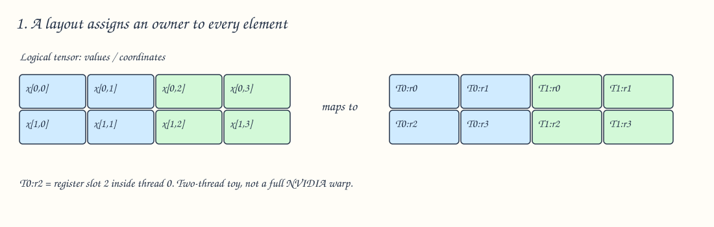

[Edit diagram](assets/tensor-layouts/01-ownership.excalidraw)

- `x[1,0]` is a **logical coordinate**.
- `T0:r2` is its **owner**: register slot 2 in thread 0.
- Every thread has its own register slots. `T0:r0` and `T1:r0` are different storage locations.
- A register patch is a drawing of logical coordinates. Registers are scalar storage, not a physical 2D array.

This is a two-thread teaching example, not a legal full NVIDIA warp configuration. Real NVIDIA warps have 32 lanes.

The layout describes the ownership of a Gluon tensor during computation. Global-memory addresses come from the pointers and strides used to load or store it. Changing the ownership map does not, by itself, transpose a matrix in memory.

## 2. Read `order` as “fastest dimension first”

For a matrix, dimension **0 = rows**, dimension **1 = columns**.

Suppose one thread owns a `2 × 4` patch:

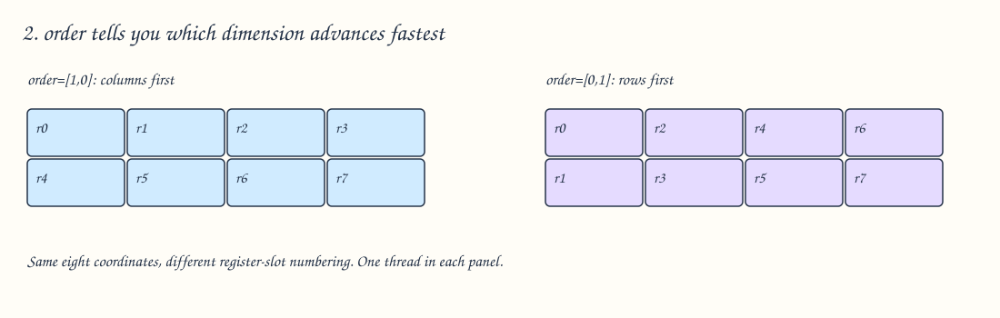

[Edit diagram](assets/tensor-layouts/02-order.excalidraw)

With `order=[1,0]`, advance the column coordinate first:

```text
(0,0) → (0,1) → (0,2) → (0,3) → (1,0) → ...
```

With `order=[0,1]`, advance the row coordinate first:

```text
(0,0) → (1,0) → (0,1) → (1,1) → (0,2) → ...
```

The phrase “rows first” in the original passage means completing a row before the next row. **“Dimension 1 changes fastest” is less ambiguous.**

`order` also determines how lane IDs and warp IDs enumerate their respective grids. It is not just a rule for numbering registers.

## 3. Expand boxes: the operation behind the whole layout

Here is another toy example: four threads arranged in a `2 × 2` grid, each holding a `2 × 2` patch.

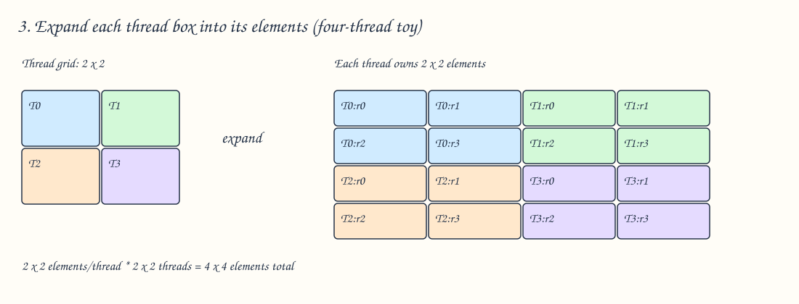

[Edit diagram](assets/tensor-layouts/03-toy.excalidraw)

Replace every thread box with its element patch:

```text
patch shape × grid of patches = total shape
   [2,2]    ×      [2,2]       =   [4,4]
```

The multiplication is elementwise. Multiply rows by rows and columns by columns.

With `order=[1,0]`, the thread grid is:

```text
T0 T1
T2 T3
```

With `order=[0,1]`, it would be:

```text
T0 T2
T1 T3
```

Register numbering inside each thread patch would change too. The total shape would still be `4 × 4`.

## 4. Your actual layout: one thread → one warp

```python
layout = gl.BlockedLayout(
    size_per_thread=[2, 4],
    threads_per_warp=[16, 2],
    warps_per_cta=[2, 2],
    order=[1, 0],
)
```

Interpret each field by asking **what kind of box it counts**:

| Field | Counts | Meaning here |
|---|---|---|
| `size_per_thread` | Elements | One thread gets a `2 × 4` patch |
| `threads_per_warp` | Thread patches | One warp arranges patches in `16 × 2` |
| `warps_per_cta` | Warp patches | One CTA arranges patches in `2 × 2` |
| `order` | Traversal of dimensions | Columns advance before rows |

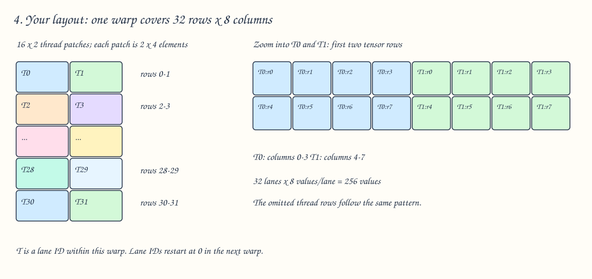

[Edit diagram](assets/tensor-layouts/04-one-warp.excalidraw)

`threads_per_warp=[16,2]` does **not** mean sixteen warps or two threads total. It means `16 × 2 = 32` threads in one warp.

Each thread patch is `2 × 4`, so one warp covers:

```text
[2,4] × [16,2] = [32,8]
```

| Lane | Tensor rows within this warp | Tensor columns within this warp |
|---|---|---|
| 0 | 0–1 | 0–3 | this means thread 0 owns elements at row 0 and 1, columns 0 through 3.
| 1 | 0–1 | 4–7 |
| 2 | 2–3 | 0–3 |
| 3 | 2–3 | 4–7 |
| 30 | 30–31 | 0–3 |
| 31 | 30–31 | 4–7 |

Every lane holds eight values. One warp holds `32 × 8 = 256` values.

### Zoom in: why `[2,4] × [16,2] = [32,8]`

**`[16,2]` counts thread patches. `[2,4]` counts elements inside each patch.** These are different units.

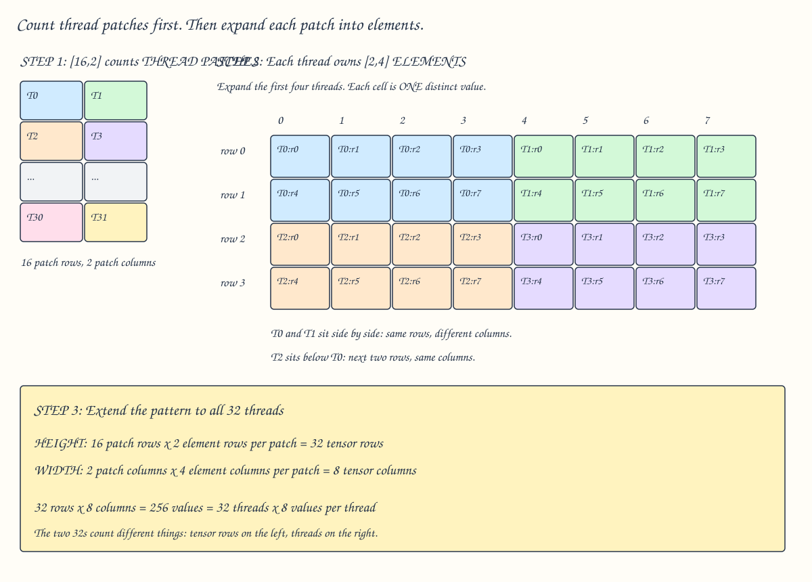

[Edit this diagram in Excalidraw](assets/tensor-layouts/04b-expand-threads.excalidraw)

Read the diagram in three steps:

1. Arrange the 32 thread patches in **16 rows and 2 columns**. This is their logical arrangement over the tensor, not their physical placement on the GPU.
2. Replace each thread patch with its **2 rows and 4 columns of elements**. T0 owns eight distinct values, labeled `T0:r0` through `T0:r7`. T1 owns another eight values in its own register slots.
3. Count the expanded rectangle: **16 × 2 = 32 element rows**, and **2 × 4 = 8 element columns**.

T1 is beside T0, so both own rows 0–1, but T1 owns columns 4–7. T2 is below T0, so both own columns 0–3, but T2 owns rows 2–3.

There are two equivalent ways to count the values:

```text
By tensor shape: 32 tensor rows × 8 tensor columns     = 256 values
By ownership:    32 threads     × 8 values per thread  = 256 values
```

The two appearances of **32** happen to match in this example. One counts tensor rows; the other counts threads. Likewise, eight columns and eight values per thread are different quantities that happen to have the same number here.

## 5. One warp → one CTA

CTA is another name for a GPU thread block. This example uses four warps, so the kernel launch must agree with that warp count.

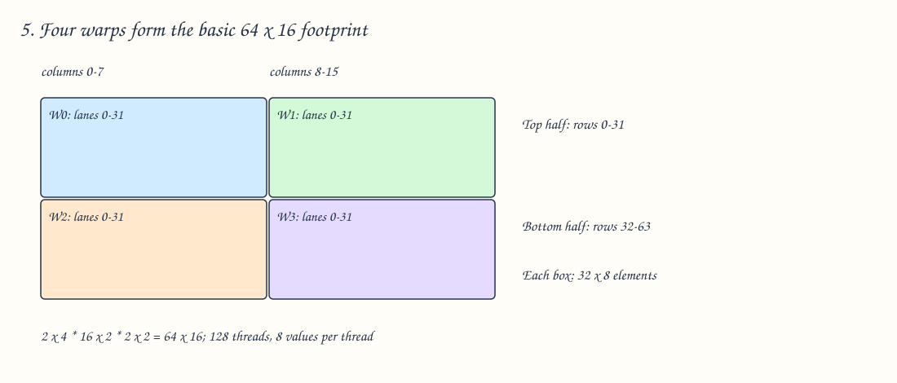

[Edit diagram](assets/tensor-layouts/05-cta.excalidraw)

Each warp covers `32 × 8`; the CTA arranges warps in `2 × 2`:

```text
[32,8] × [2,2] = [64,16]
```

With `order=[1,0]`, warp IDs advance horizontally first:

```text
W0 W1
W2 W3
```

Lane IDs restart in each warp. To distinguish all threads, use `(warp, lane)` or a CTA-wide thread ID:

```text
thread_id = 32 * warp_id + lane_id
```

Thus warp 3, lane 3 is CTA thread 99.

**Important vocabulary:** the `64 × 16` layout “block shape” is the basic tensor footprint covered by the ownership pattern. A GPU thread block is the group of 128 executing threads. Those two uses of “block” are related, but are different objects.

## 6. Find the owner of an element

Take `x[35,13]` in a `64 × 16` tensor.

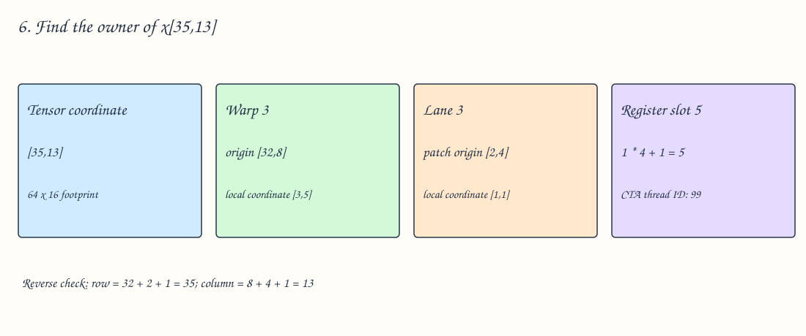

[Edit diagram](assets/tensor-layouts/06-trace.excalidraw)

### Step 1: Find the warp — bottom row, right column

One warp covers **32 rows × 8 columns**. Divide the tensor into four rectangles and label them across the top row first, then across the bottom row. This numbering follows `order=[1,0]`.

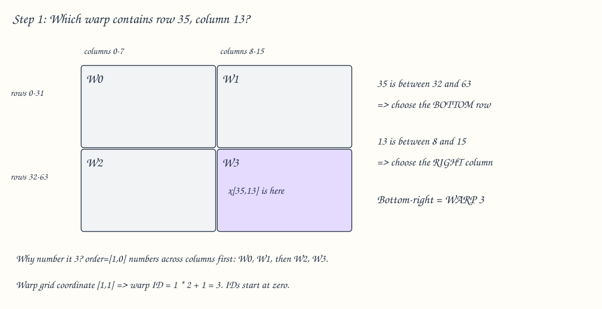

[Edit diagram](assets/tensor-layouts/06a-find-warp.excalidraw)

Row **35** is in the range **32–63**. Column **13** is in the range **8–15**. Their intersection is the bottom-right rectangle: **warp 3**. All indices start at zero.

### Step 2: Find the position inside that warp

Warp 3 starts at tensor coordinate `[32,8]`. Pretend its top-left corner is now `[0,0]`: subtract that starting coordinate from the target.

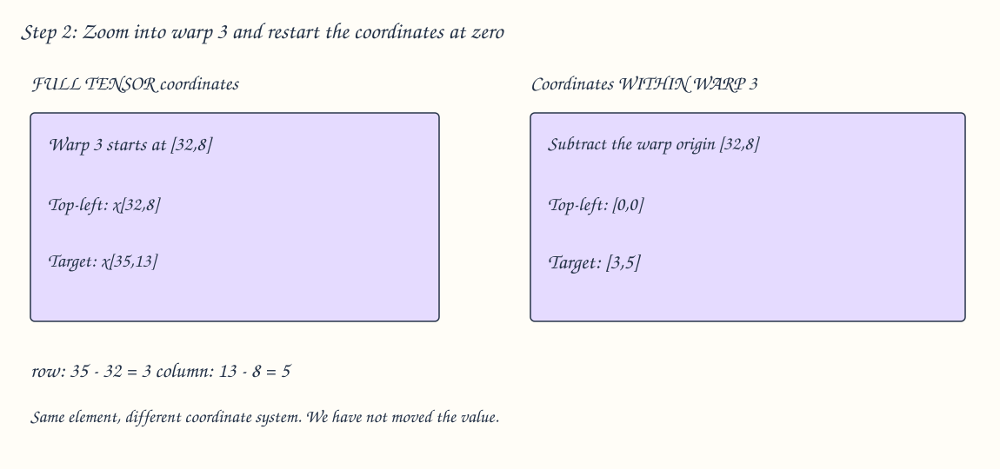

[Edit diagram](assets/tensor-layouts/06b-warp-local.excalidraw)

```text
Full tensor: [35,13]
Warp origin: [32, 8]
Subtract:    [ 3, 5]  ← position within warp 3
```

The element has not moved. We are describing its position relative to a smaller rectangle.

### Step 3: Find the lane inside the warp

Each lane owns a **2-row × 4-column** patch. Look for the patch containing warp-local coordinate `[3,5]`.

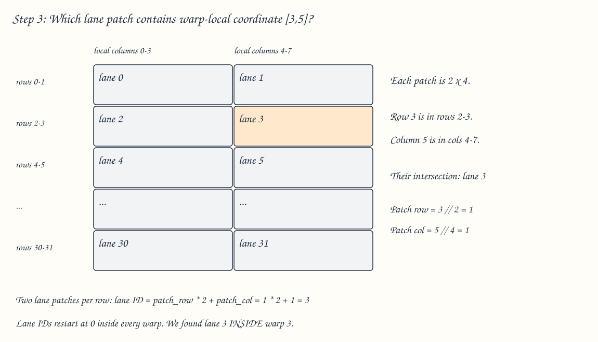

[Edit diagram](assets/tensor-layouts/06c-find-lane.excalidraw)

Local row **3** is in rows **2–3**, the second row of patches. Local column **5** is in columns **4–7**, the second column of patches. That patch is **lane 3**:

```text
lane 0 | lane 1
lane 2 | lane 3  ← here
  ...  |  ...
```

In arithmetic, the patch coordinate is `[3 // 2, 5 // 4] = [1,1]`. With two patches per row, its ID is `1*2 + 1 = 3`. Here `//` means integer division: count how many complete patches precede the coordinate.

### Step 4: Find the position inside the lane's patch

Lane 3's patch begins at **warp-local** coordinate `[2,4]`. Subtract that origin from `[3,5]`.

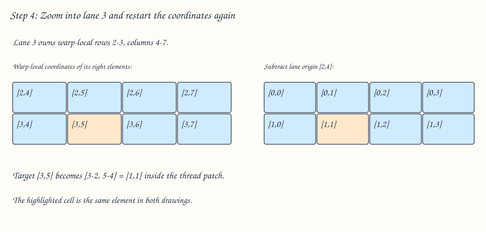

[Edit diagram](assets/tensor-layouts/06d-lane-local.excalidraw)

```text
Within the warp: [3,5]
Lane origin:     [2,4]
Subtract:        [1,1]  ← position inside lane 3's patch
```

The highlighted element is in the **second row and second column** of the lane's patch. Because coordinates start at zero, that position is `[1,1]`.

### Step 5: Find the register slot

Number the lane's eight slots across each row. This again follows `order=[1,0]`.

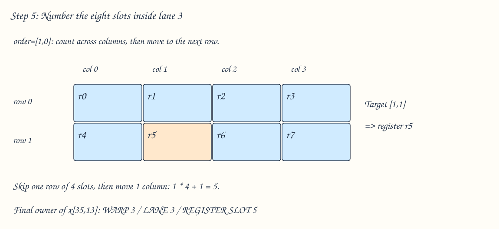

[Edit diagram](assets/tensor-layouts/06e-find-register.excalidraw)

At `[1,1]`, skip one whole row of four slots and advance one column: `1*4 + 1 = 5`. The slot is **r5**.

We have followed the same element through three coordinate systems:

| Coordinate system | Target position | What we find |
|---|---|---|
| Full tensor | `[35,13]` | Warp 3 |
| Inside warp 3 | `[3,5]` | Lane 3 |
| Inside lane 3's patch | `[1,1]` | Register slot 5 |

**`x[35,13]` belongs to warp 3, lane 3, register slot 5.** Warp ID 3 and lane ID 3 happen to match here; they were found independently at different levels.

### Optional: express the pictures as a formula

For this exact layout and its basic footprint, the forward mapping is:

```python
row = 32 * (warp // 2) + 2 * (lane // 2) + register // 4
col =  8 * (warp % 2)  + 4 * (lane % 2)  + register % 4
# warp: 0..3, lane: 0..31, register: 0..7
```

Try the reverse direction: warp 2, lane 5, register 6.

```text
row = 32*1 + 2*2 + 1 = 37
col =  8*0 + 4*1 + 2 =  6

Owner (W2, lane 5, r6) holds x[37,6].
```

These formulas are specific to the parameters above; changing `order` or the tiling factors changes the mapping.

## 7. A larger tensor: more values in the same threads

Keep the layout, but make the tensor `128 × 128`.

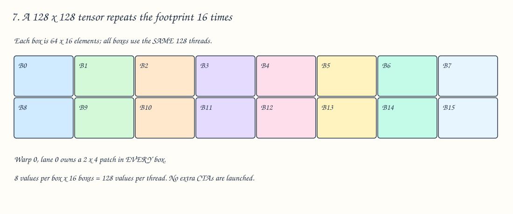

[Edit diagram](assets/tensor-layouts/07-larger.excalidraw)

The `64 × 16` footprint fits twice vertically and eight times horizontally:

```text
[128,128] / [64,16] = [2,8] repetitions
```

**All 16 boxes use the same 128 threads.** `B0` through `B15` are not new CTAs.

For example, warp 0, lane 0 holds:

| Repetition | Its patch | Logical register slots |
|---|---|---|
| B0 | Rows 0–1, columns 0–3 | 0–7 |
| B1 | Rows 0–1, columns 16–19 | 8–15 |
| B2 | Rows 0–1, columns 32–35 | 16–23 |
| B8 | Rows 64–65, columns 0–3 | 64–71 |
| B15 | Rows 64–65, columns 112–115 | 120–127 |

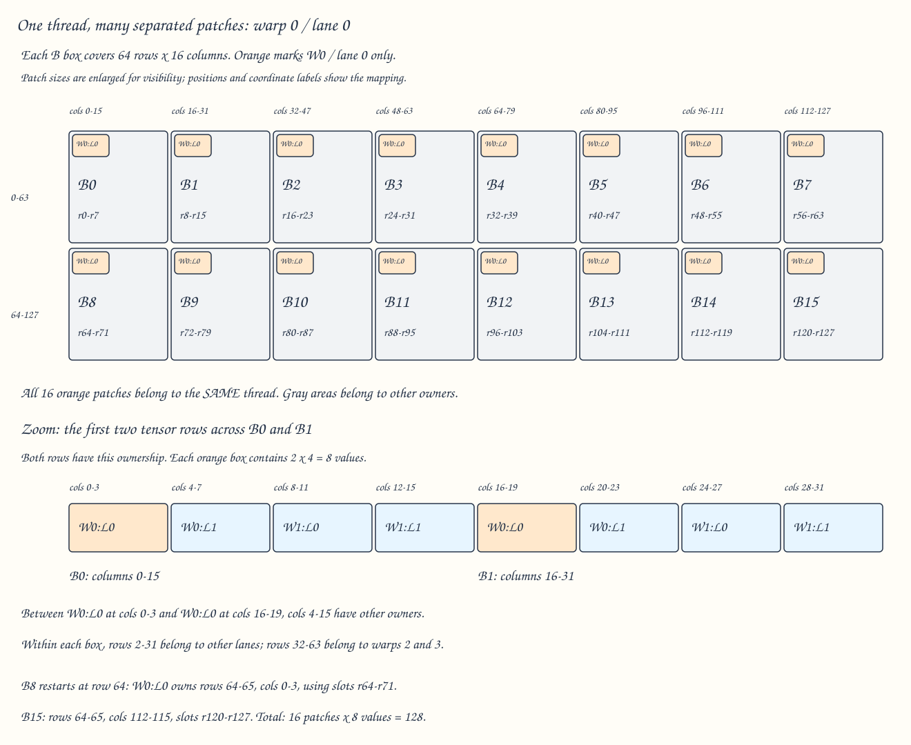

[Edit diagram in Excalidraw](assets/tensor-layouts/07b-lane-across-repeats.excalidraw)

**Follow the orange patches:** every orange patch belongs to the same thread, warp 0 / lane 0. Its patch is always at the top-left of each repeated `64 × 16` footprint. Moving one box right adds **16** to its tensor column coordinates; moving one box down adds **64** to its tensor row coordinates. The orange patches are enlarged in the overview so they remain visible.

The gap between these patches is occupied by other threads and warps. The zoom shows the owners for tensor rows 0–1:

| Columns | Owner | Repetition |
|---|---|---|
| 0–3 | Warp 0, lane 0 | B0 |
| 4–7 | Warp 0, lane 1 | B0 |
| 8–11 | Warp 1, lane 0 | B0 |
| 12–15 | Warp 1, lane 1 | B0 |
| 16–19 | Warp 0, lane 0 again | B1 |

So lane 0 does not hold every column between its patches. Other owners fill that space. Its own logical register slots continue consecutively: B0 uses slots 0–7, B1 uses 8–15, and so on, even though the tensor coordinates are separated.


Each thread now holds `8 × 16 = 128` values. Check the total:

```text
128 threads × 128 values/thread = 16,384 values = 128 × 128
```

You can extend the previous coordinate formula. For register slot `q` in `0..127`:

```python
repeat = q // 8
register = q % 8
row = 64 * (repeat // 8) + 32 * (warp // 2) + 2 * (lane // 2) + register // 4
col = 16 * (repeat % 8)  +  8 * (warp % 2)  + 4 * (lane % 2)  + register % 4
```

Example: `x[99,125]` is in B15, at local coordinate `[35,13]`. From example 6, that is warp 3, lane 3, local register 5. Its full register slot is `15*8 + 5 = 125`.

## 8. A smaller tensor: duplicate ownership across warps

```
size_per_thread = [2, 4]
threads_per_warp = [16, 2]
warps_per_cta = [2, 2]
```

Now make the tensor `32 × 8`. One warp's footprint already covers the entire tensor.

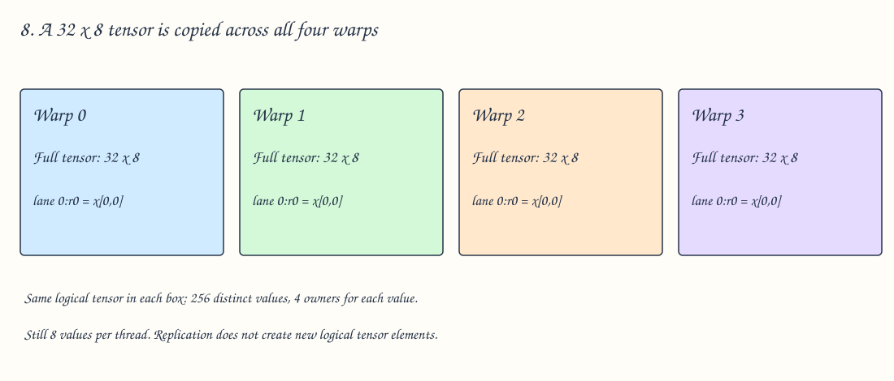

[Edit diagram](assets/tensor-layouts/08-smaller.excalidraw)

The layout still specifies four warps. Each warp holds the **same logical tensor**.

| Logical element | Owners |
|---|---|
| `x[0,0]` | Lane 0, r0 in W0, W1, W2, W3 |
| `x[0,7]` | Lane 1, r3 in W0, W1, W2, W3 |
| `x[31,7]` | Lane 31, r7 in W0, W1, W2, W3 |

There are 256 distinct elements, but `4 × 256 = 1024` element slots across the threads.

This is **replication of ownership**, not zero padding. The extra owners hold copies of existing logical elements. The diagram describes a mapping; it does not imply a runtime broadcast instruction must execute.

### A halfway case: shape 32 × 16

Only the row dimension is smaller than the footprint:

```text
W0 and W2 own the same left half:  rows 0–31, columns 0–7
W1 and W3 own the same right half: rows 0–31, columns 8–15
```

Each element has two owners. For shape `64 × 8`, replication instead happens between W0/W1 and W2/W3.

## 9. Smaller still: duplication across lanes and register slots

For shape `2 × 4`, a single thread patch can cover the whole tensor.

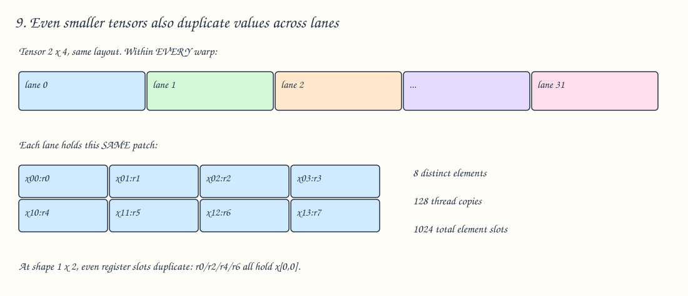

[Edit diagram](assets/tensor-layouts/09-replication.excalidraw)

All 128 threads hold the same eight elements. Within every thread, r0 holds `x[0,0]`, r1 holds `x[0,1]`, and so on.

For shape `1 × 2`, even the per-thread patch is too large:

```text
Register slot:    r0   r1   r2   r3   r4   r5   r6   r7
Logical element: x00  x01  x00  x01  x00  x01  x00  x01
```

That is the layout's logical replication down to register slots. Do not interpret this as a promise that the compiler will emit eight separate physical registers for two identical live values: optimization can eliminate redundant storage.

For these smaller shapes, you can picture taking coordinates from the base `64 × 16` map and wrapping them into the tensor's dimensions. This shortcut applies to the power-of-two examples here; it is not a general definition for every Gluon layout.

## 10. A one-dimensional example

```python
layout = gl.BlockedLayout(
    size_per_thread=[2],
    threads_per_warp=[32],
    warps_per_cta=[1],
    order=[0],
)
```

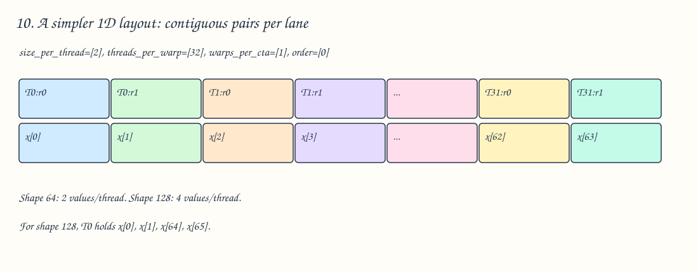

[Edit diagram](assets/tensor-layouts/10-1d.excalidraw)

The base footprint is `2 × 32 × 1 = 64` elements.

| Tensor shape | What lane 0 owns | What lane 1 owns |
|---|---|---|
| `[64]` | `x[0], x[1]` | `x[2], x[3]` |
| `[128]` | `x[0], x[1], x[64], x[65]` | `x[2], x[3], x[66], x[67]` |
| `[32]` | `x[0], x[1]` | `x[2], x[3]` |

In the `[32]` case, lanes 16–31 duplicate lanes 0–15. Lane 16 also owns `x[0], x[1]`.

Changing `size_per_thread` from `[2]` to `[1]` makes adjacent lanes own adjacent elements in the first pass: lane 0 gets `x[0]`, lane 1 gets `x[1]`, and so on. For shape `[64]`, lane 0 then gets `x[0]` and `x[32]`. Same tensor and thread count, different ownership.

## 11. Compare the shapes at a glance

This table uses the original **2D** layout throughout.

| Tensor shape | Distinct elements | Values/slots per thread in the layout | Total slots across 128 threads | Copies per logical element |
|---|---:|---:|---:|---:|
| `64 × 16` | 1024 | 8 | 1024 | 1 |
| `128 × 128` | 16384 | 128 | 16384 | 1 |
| `32 × 16` | 512 | 8 | 1024 | 2 |
| `32 × 8` | 256 | 8 | 1024 | 4 |
| `2 × 4` | 8 | 8 | 1024 | 128 |
| `1 × 2` | 2 | 8 | 1024 | 512 |

For an `f32` tensor, each independent scalar value needs a 32-bit storage slot when held in a register. These counts help reason about register pressure, but **the final kernel register count is a compiler result**, affected by live ranges, other values, optimization, and possible spills. Layout register numbers are explanatory slots, not physical register names from machine code.

Larger and smaller dimensions can also occur together. For shape `128 × 8`, rows repeat twice while warp columns duplicate. There are 16 slots per thread and two owners per logical element.

## 12. Check your understanding

Try these before opening the answers. Use the original 2D layout unless stated otherwise.

1. For shape `64 × 16`, who owns `x[0,4]`?
2. Who owns `x[2,0]`?
3. Who owns `x[32,8]`?
4. Which element belongs to warp 1, lane 2, register 7?
5. For shape `128 × 128`, how many threads are added?
6. For shape `32 × 8`, how many owners does `x[0,0]` have?
7. If `order` becomes `[0,1]`, does the base footprint change?

<details>
<summary>Answers with reasoning</summary>

1. **W0, lane 1, r0.** Column 4 begins the second thread patch.
2. **W0, lane 2, r0.** Row 2 begins the second row of thread patches.
3. **W3, lane 0, r0.** This is the origin of the bottom-right warp patch.
4. **`x[3,11]`.** W1 starts at `[0,8]`; lane 2 adds `[2,0]`; r7 adds `[1,3]`.
5. **Zero.** The same 128 threads each hold 128 values instead of eight.
6. **Four.** Lane 0, r0 in each warp.
7. **No.** Elementwise products still give `64 × 16`. Register, lane, and warp numbering across that footprint change.

</details>

## Sources and scope

- [Gluon Tensor Layouts tutorial](https://triton-lang.org/main/getting-started/tutorials/gluon/layouts.html) — source of the original example, repetition, and replication rules.
- [BlockedLayout API](https://triton-lang.org/main/gluon/api/generated/triton.experimental.gluon.language.BlockedLayout.html) — parameter definitions and layout inspection methods.

The examples assume NVIDIA's 32-lane warps and a single CTA's distributed tensor. Small toy grids are explicitly labeled. Specialized MMA layouts, shared-memory layouts, and multi-CTA layouts need their own diagrams; the formulas here describe the stated blocked layouts.
